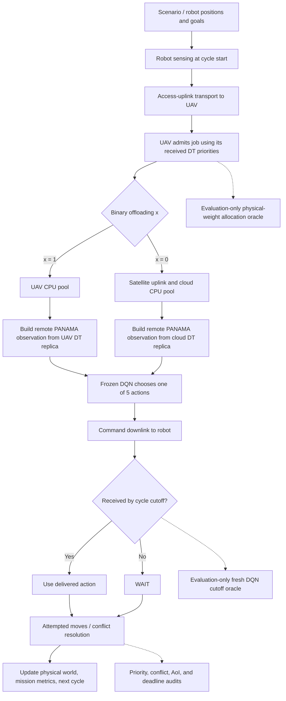

# SANGIN-dev: Architecture, Execution Walkthrough, and Validation Handbook

> **Purpose:** A code-grounded guide to understanding and independently checking the SAGIN remote-digital-twin / frozen-PANAMA / multi-agent path-finding experiments.
>
> **Repository:** [arman-dogru/SANGIN-dev](https://github.com/arman-dogru/SANGIN-dev)  
> **Reviewed `main` commit:** [`6a6198a724a09cf944de9995f3d7c7f65c122e7e`](https://github.com/arman-dogru/SANGIN-dev/commit/6a6198a724a09cf944de9995f3d7c7f65c122e7e)  
> **Document scope:** Explains the code as reviewed at this commit; adjust references after subsequent changes. Describes implementation and validation procedures, **not proof of scientific performance**. The locally generated outputs, orbital timeline, and qualified DQN checkpoint are not included in Git.

## Contents

- [SANGIN-dev: Architecture, Execution Walkthrough, and Validation Handbook](#sangin-dev-architecture-execution-walkthrough-and-validation-handbook)
  - [Contents](#contents)
  - [1. Mental model and end-to-end execution graph](#1-mental-model-and-end-to-end-execution-graph)
  - [2. Repository map](#2-repository-map)
  - [3. CLI, configuration, and experimental identity](#3-cli-configuration-and-experimental-identity)
  - [4. Scenarios, robots, A\* paths, and physical priorities](#4-scenarios-robots-a-paths-and-physical-priorities)
  - [5. What happens during one remote control cycle](#5-what-happens-during-one-remote-control-cycle)
    - [Example timing inspection](#example-timing-inspection)
  - [6. Transport, RF, LEO, and UAV placement](#6-transport-rf-leo-and-uav-placement)
  - [7. Allocation: objective, binary routes, relaxation, and CPU rates](#7-allocation-objective-binary-routes-relaxation-and-cpu-rates)
  - [8. DT replicas, observation construction, and frozen PANAMA](#8-dt-replicas-observation-construction-and-frozen-panama)
  - [9. Command acceptance, physical motion, and post-goal behavior](#9-command-acceptance-physical-motion-and-post-goal-behavior)
  - [10. Oracle calculations and what they can actually establish](#10-oracle-calculations-and-what-they-can-actually-establish)
  - [11. Ordering, path-conflict metrics, AoI, and vertex-only extension](#11-ordering-path-conflict-metrics-aoi-and-vertex-only-extension)
  - [12. Task deadlines and latency accounting](#12-task-deadlines-and-latency-accounting)
  - [13. Experiment designs: 100 ms, accepted 250 ms, deadline sensitivity](#13-experiment-designs-100-ms-accepted-250-ms-deadline-sensitivity)
  - [14. Priority research report and statistical inference](#14-priority-research-report-and-statistical-inference)
  - [15. Controlled peer-staleness stress pilot (latest addition)](#15-controlled-peer-staleness-stress-pilot-latest-addition)
    - [Intervention](#intervention)
    - [Stress geometries and protocol](#stress-geometries-and-protocol)
  - [16. Archives, deterministic replay, and independent checks](#16-archives-deterministic-replay-and-independent-checks)
    - [What replay checks](#what-replay-checks)
    - [Inspect a single saved episode](#inspect-a-single-saved-episode)
  - [17. Copy/paste validation commands](#17-copypaste-validation-commands)

---

## 1. Mental model and end-to-end execution graph

A group of grid robots moves toward separate goals. Each active robot senses local obstacle/occupancy information, uploads it to a UAV, and needs a movement action generated by a **frozen PANAMA DQN**. The UAV admits each incoming job independently; its resource allocator chooses either **UAV CPU** or **cloud CPU** (reached over satellite backhaul). The chosen processing location constructs the PANAMA observation from the uploaded sensing and its **own network-delivered DT replica**. The resulting action returns to the robot. The robot uses a valid current-cycle command only if it arrives by the cutoff; otherwise the action is **WAIT (4)**. Physical movement and possible conflicts are then recorded.



**Four states must never be conflated:** (1) true physical world; (2) UAV and cloud DT replicas; (3) caches received by individual robots; (4) the actual delivered-and-used movement command. The oracle reads physical truth **for evaluation only**.

**Two clocks:** the control interval is **1 second**. The nominal accepted full evaluation uses a **250 ms** command cutoff and monitored deadline, whereas the earlier diagnostic configuration remains **100 ms**. The cutoff is measured from sensing at the beginning of a cycle; it is not the length of the robot movement step.

## 2. Repository map

| File or directory | Purpose / starting symbol |
|---|---|
| [`src/panama_uav/__main__.py`](src/panama_uav/__main__.py), [`cli.py`](src/panama_uav/cli.py) | `python -m panama_uav`, CLI dispatch |
| [`configs/paper_remote_dt.toml`](configs/paper_remote_dt.toml) | 100 ms diagnostic remote-DT configuration; non-diagnostic gate remains closed |
| [`configs/paper_remote_dt_250ms.toml`](configs/paper_remote_dt_250ms.toml) | Accepted 250 ms full-evaluation protocol |
| [`src/panama_uav/config.py`](src/panama_uav/config.py) | `load_config`, `ResourceAllocationConfig`, `TransportConfig` |
| [`src/panama_uav/scenarios.py`](src/panama_uav/scenarios.py), [`environment.py`](src/panama_uav/environment.py) | Map loading, physical robots, A*, observation, `reset`, `step` |
| [`src/panama_uav/evaluation.py`](src/panama_uav/evaluation.py) | `case_bank`, `run_episode` |
| [`src/panama_uav/resource_study.py`](src/panama_uav/resource_study.py) | `conditions`, `run_study`, archive/metrics/pairing |
| [`src/panama_uav/remote.py`](src/panama_uav/remote.py) | `RemoteDTCommunication`: remote sensing, admission, inference, command, oracle |
| [`src/panama_uav/paper.py`](src/panama_uav/paper.py) | Shared support-mode base and priority-weight policy logic |
| [`src/panama_uav/transport.py`](src/panama_uav/transport.py), [`event_calendar.py`](src/panama_uav/event_calendar.py) | Event-driven packet and simulated-time service |
| [`src/panama_uav/uav.py`](src/panama_uav/uav.py), [`paper_radio.py`](src/panama_uav/paper_radio.py) | UAV placement, urban path loss, RF transmission budgets |
| [`src/panama_uav/leo.py`](src/panama_uav/leo.py), [`leo_radio.py`](src/panama_uav/leo_radio.py) | Archived orbit service, geometry, link budgets, handovers |
| [`src/panama_uav/allocation.py`](src/panama_uav/allocation.py) | Weight mapping, binary search, conic relaxation, CPU fractions |
| [`src/panama_uav/compute.py`](src/panama_uav/compute.py) | Finite UAV/cloud CPU pools and time-varying processor shares |
| [`src/panama_uav/remote_state.py`](src/panama_uav/remote_state.py) | `PhysicalReport`, `DTState`, `DTReplica`, `ActionCommand`, `CommandInbox`, DQN input |
| [`src/panama_uav/models.py`](src/panama_uav/models.py), [`training.py`](src/panama_uav/training.py) | Frozen DQN architecture, action selection and checkpoint qualification |
| [`src/panama_uav/remote_control.py`](src/panama_uav/remote_control.py) | Physical conflict detection/resolution and post-goal local controller |
| [`src/panama_uav/consistency.py`](src/panama_uav/consistency.py) | Six ordering quantities, FoV conflict gating, AoI, exploratory vertex-only metric |
| [`src/panama_uav/task_deadlines.py`](src/panama_uav/task_deadlines.py) | Read-only sensing-to-command-arrival compliance |
| [`src/panama_uav/remote_metrics.py`](src/panama_uav/remote_metrics.py) | Network, compute, command, oracle and deadline counters |
| [`src/panama_uav/remote_audit.py`](src/panama_uav/remote_audit.py) | Replays DT stores, inbox, observations, decisions and motion |
| [`src/panama_uav/deadline_study.py`](src/panama_uav/deadline_study.py) | Actual paired 100/250/300/500 ms cutoff sensitivity |
| [`src/panama_uav/priority_evaluation.py`](src/panama_uav/priority_evaluation.py), [`priority_locations.py`](src/panama_uav/priority_locations.py) | Audited 250 ms priority-service and site-conditional analysis |
| [`src/panama_uav/controlled_scenarios.py`](src/panama_uav/controlled_scenarios.py) | Three deterministic high-coordination stress geometries |
| [`src/panama_uav/staleness_remote.py`](src/panama_uav/staleness_remote.py), [`staleness_state.py`](src/panama_uav/staleness_state.py) | Inject controlled peer-view delay at the inference read |
| [`src/panama_uav/staleness_study.py`](src/panama_uav/staleness_study.py), [`staleness_audit.py`](src/panama_uav/staleness_audit.py) | Bounded stress pilot, contrasts and replay |
| [`REMOTE_DT.md`](REMOTE_DT.md), [`PRIORITY_EVALUATION.md`](PRIORITY_EVALUATION.md), [`CONTROLLED_STALENESS.md`](CONTROLLED_STALENESS.md) | Detailed existing technical protocols and limitations |
| [`tests/`](tests/) | Unit, boundary, replay, numerical, full-run-gate and regression tests |

For the **current scientific pipeline**, read `cli.py` → `resource_study.py` → `evaluation.py` → `environment.py` → `remote.py`, then branch into `transport.py`, `allocation.py`, `compute.py`, `remote_state.py`, `models.py`, and `consistency.py`. `paper.py`/`information.py` also matter as inheritance and legacy baselines, but **`remote_dt` is the actual remote-execution path**.

## 3. CLI, configuration, and experimental identity

[`__main__.py`](src/panama_uav/__main__.py) only dispatches to the command line:

```python
from .cli import main

if __name__ == "__main__":
    raise SystemExit(main())
```

`cli.py` parses `--config`, chooses a command, and calls `run_study`, `run_deadline_study`, `report_priority_study`, `run_stress_pilot`, or replay/sanity routines. For the main experiment, the path is:

```python
# cli.py, resource-study branch (abridged)
from .resource_study import run_study
summary = run_study(config, root, arguments.model, arguments.diagnostic,
    arguments.cases, tuple(arguments.agents), ...)
```

Load both the `[communication]` and `[resource_allocation]` sections through [`config.py`](src/panama_uav/config.py). Parameters governing outcomes include: `seconds_per_step`, `decision_budget_seconds`, `command_cutoff_seconds`, `task_deadline_seconds`, `enforce_task_deadlines`, `execution_mode`, `policy`, `equal_weight_mode`, `on_collision`, radio limits, CPU capacities, and the LEO timeline path.

**Current distinction to preserve:**

| Config | Decision + command cutoff + measured deadline | Full-run gate | Intended use |
|---|---:|---|---|
| [`paper_remote_dt.toml`](configs/paper_remote_dt.toml) | 100 ms | Not approved | Diagnostics / sensitivity starting point |
| [`paper_remote_dt_250ms.toml`](configs/paper_remote_dt_250ms.toml) | 250 ms | Explicitly approved | Accepted priority evaluation |

The **1 s movement interval** remains the same in both. The 250 ms protocol keeps `enforce_task_deadlines=false`: late tasks are **measured**, not rejected by a hard-constraint solver. `configs/paper_study.toml` is the historical support/legacy setting, not the same remote execution architecture.

A non-diagnostic `resource-study` validates the full paper requirements: **50 paired cases**, populations **2/4/6/8**, **250-step cap**, qualified checkpoint, available orbital timeline, and the `remote_acceptance_approved` gate. Do not bypass the gate with `--diagnostic` and describe the result as a full paper evaluation.

Run manifests save the actual resolved configuration, Git commit, hashes of Python files, checkpoint, map, case bank and timeline, package versions, conditions and diagnostic flag. Treat the **manifest** as the authoritative record of what was run.

## 4. Scenarios, robots, A* paths, and physical priorities

[`evaluation.py:case_bank()`](src/panama_uav/evaluation.py) generates the same map/start/goal set across treatment conditions. Its deterministic seed structure is:

```python
seed = 50_000_000 + count * 10_000 + case
```

[`environment.py:reset()`](src/panama_uav/environment.py) creates each `Agent`, initializes the grid, builds an A* route, sets initial goal distance and priorities, initializes the UAV controller, then constructs the communication implementation.

[`environment.py:astar_path()`](src/panama_uav/environment.py) is a grid-path reference for intentions and distance. **The learned DQN chooses the executed movement**; A* does not directly move a robot.

The physical priority code assigns smaller values to agents with shorter remaining A* distances, and pushes already completed agents to low priority:

```python
# environment.py: _refresh_priorities (excerpt)
if agent.ever_reached_goal:
    agent.priority = settled + agent.id * 1e-6
else:
    distance = agent.distance_to_goal if math.isfinite(agent.distance_to_goal) else settled-1
    agent.priority = distance + agent.id * 1e-6
```

Thus **smaller PANAMA rho means higher priority**. The small robot-ID offset breaks ties. Check the raw physical priority and A* distance at each cycle: they must not be confused with what the UAV, cloud or peer robot currently knows.

`environment.py:reset()` chooses the remote communication class explicitly:

```python
# environment.py (excerpt)
if self.config.resource_allocation.execution_mode == "remote_dt":
    from .remote import RemoteDTCommunication
    communication_class = self.remote_communication_class or RemoteDTCommunication
    self.communication = communication_class(...)
```

The `remote_communication_class` override also supports the bounded controlled-staleness experiment without changing the default mode.

## 5. What happens during one remote control cycle

Trace **one** job such as `1:0` (cycle 1, robot 0) all the way through. These are actual execution functions, not merely a conceptual drawing.

1. **Cycle begins.** `environment.step` updates physical positions/priorities and `remote.py:update(agents, now)` emits new sensing reports. Initial cycle-zero setup occurs at reset. The physical control clock has 1 s intervals.
2. **Robot senses.** `remote.py:_sense()` records its current position, goal, completed flag, obstacles and other robots in its square FoV. Its `PhysicalReport` has the sensing timestamp. This is **not yet the final DQN tensor**.
3. **Access upload.** `remote.py:update()` creates `job_id=f"{self.current_cycle}:{agent.id}"`, records `source_time=now`, `deadline_at=now+task_deadline_seconds`, and sends `remote_robot_observation` via route `("access_up",)`.
4. **UAV receives.** `transport.advance(..., remote._receive)` delivers the complete packet. `remote.py:_receive()` records `access_arrived_at` and calls `_admit(payload)` **immediately**. There is no barrier waiting for all robots' reports.
5. **Allocate route and CPU.** `_admit()` reads the UAV DT replica, makes a snapshot containing this new task plus previously admitted jobs with fixed routes, runs `compare_allocations`, and executes the **binary** chosen route `x`.
6. **Run CPU.** `x=1` goes into the UAV `ComputePool`; `x=0` traverses `satellite_up`, reaches the cloud and enters cloud `ComputePool`. Processor shares may change when other tasks arrive or finish.
7. **Remote inference.** At completion, `remote.py:_finish()` constructs `remote_observation(...)` from that robot's *uploaded* sensing and peers in the *chosen location's* DT replica; it runs the frozen DQN, records observation/hash/dependencies/DT versions and creates an `ActionCommand`.
8. **Download command.** UAV execution sends via `("access_down",)`; cloud execution sends via `("satellite_down", "access_down")`. Robot-side guidance state updates travel as separate messages.
9. **Robot cutoff.** `remote.py:prepare_decision()` advances transport to `cycle_start+decision_budget_seconds`, takes a valid same-cycle inbox command, or selects action 4 (**WAIT**). No late command gets executed next cycle.
10. **Physical motion.** `environment.py:step()` requires that remote actions match the delivered set, detects attempted vertex/edge conflicts, resolves them by configured `dt_resolve` delivered priorities (or terminates in the optional collision-failure mode), and updates positions/goals.
11. **Evaluation-only work.** Allocation oracle snapshots, compute-time action shadows, per-cutoff oracle DQN actions, ordering/conflict snapshots and deadline counters are logged. None is supposed to modify actual physical motion.
12. **Next epoch and archive.** The environment progresses to the next whole-second cycle; `evaluation.py:run_episode()` records frames and events. Each finished episode is replay-audited and archived.

A condensed code path:

```python
# evaluation.py: run_episode() (structural excerpt)
env.reset()
env.prepare_decision(config.resource_allocation.decision_budget_seconds)
while True:
    actions = dict(env.communication.execution_actions)  # remote mode
    result = env.step(actions)
    if result.terminated or result.truncated:
        break
    env.prepare_decision(config.resource_allocation.decision_budget_seconds)
```

In the actual function, `run_episode` also gathers frames, rewards, counters and archives. **Remote physical actions are taken from `execution_actions`, not by calling a local `select_actions()` at movement time.**

### Example timing inspection

For sensing at `1.000` s and a 250 ms cutoff, `1.240` s command arrival is on time and `1.260` s is late. For the old 100 ms config, the same arrivals would both be late. These are **examples**, not claims about a saved run.

An important causality chain to check for each job:

```text
sensing <= access arrival <= allocation <= compute-location arrival
        <= compute finish <= command generation <= first command arrival
```

A cloud job has satellite upload between allocation and compute-location arrival. Some CPU states and DT synchronization messages occur in parallel, so **do not** require a global total ordering of all unrelated message events.

## 6. Transport, RF, LEO, and UAV placement

[`transport.py:Transport`](src/panama_uav/transport.py) maintains four directed links: `access_up`, `access_down`, `satellite_up`, `satellite_down`. `send()` serializes payloads, adds envelope/packet overhead and queues traffic. `_start()` selects eligible agents and serves finite bits at a rate capped by link capacity and RF per-agent limits. `advance()` consumes event-calendar entries (transmission completion, next-hop enqueue, compute ticks, handovers, etc.).

```python
# transport.py: _start() (exact key operations)
capacity_bps = min(link.capacity_bps, self.agent_rate_caps.get((agent, name), link.capacity_bps))
duration = wire_bytes * 8 / capacity_bps
```

Depending on configuration, delay may include queue waiting, packet overhead and fragmentation, satellite propagation, orbital capacity, scheduler-frame guards and handover interruption. A remote response is a **complete delivered message**, not a partially transmitted packet.

[`uav.py`](src/panama_uav/uav.py) models the UAV's air-to-ground path loss and its position/altitude controller. `environment.py:step()` calls the UAV update using **successfully received report positions**, not current robot ground truth. [`paper_radio.py:access_budget()`](src/panama_uav/paper_radio.py) caps Shannon capacity by the configured bandwidth/ceiling:

\[
R_{UL}=\min\{R_{cap},\ B\log_2(1+\mathrm{SNR})\}.
\]

[`paper_radio.py:backhaul_budget()`](src/panama_uav/paper_radio.py) derives the backhaul rate and configured/orbital delay, with separate space legs and a ground/gateway contribution. [`leo.py`](src/panama_uav/leo.py) reads the local orbital timeline and supplies time-varying service/propagation/handover; [`leo_radio.py`](src/panama_uav/leo_radio.py) holds geometry/attenuation link assumptions. An orbital asset must be present locally for the documented full experiments.

**Validate:** check `time`, `queue_seconds`, `transmission_seconds`, `propagation_seconds`, `handover_seconds`, `frame_guard_seconds` per transmission. Unit sanity is essential: `bits / (bits/s) = s`; energy is `W × s = J`. Packet transport rates are **not** the same as CPU cycle rates. `contention_enabled=false` disables the *legacy reservation-exposure disturbance*, **not** the finite physical link queues.

The simulator models RF capacity/geometry; it does **not** claim calibrated packet loss or retransmission, nor cloud electricity or UAV propulsion energy.

## 7. Allocation: objective, binary routes, relaxation, and CPU rates

[`allocation.py`](src/panama_uav/allocation.py) is the optimization core. Each `AllocationTask` includes bits, cycles/bit or remaining cycles, priority-derived weight, available access/backhaul rates, energy parameters, optional fixed route and optional hard deadline.

The task's nominal work is:

\[
C_i=s_i c_i=100{,}000\,\mathrm{bits}\times1000\,\mathrm{cycles/bit}=10^8\,\mathrm{cycles}.
\]

**PANAMA priority (`rho`) versus allocation weight (`pi`)**: smaller rho = higher priority; for active robots the optimizer maps priority **inversely** into a bounded importance weight in `[1,4]`:

\[
\pi_i=\pi_{min}+(\pi_{max}-\pi_{min})\frac{\rho_{max}-\rho_i}{\rho_{max}-\rho_{min}}.
\]

Equal-priority active robots are specially handled; completed robots receive the minimum weight. The map is in `allocation.py:priority_weights()`. `paper.py:_weights()` implements priority/equal/static/AoI policies. `remote.py:_available_weights()` obtains **UAV-delivered** priorities and AoI, with a matched-active-mean equal baseline for the accepted priority study.

The optimizer minimizes a weighted latency plus modeled energy objective, conceptually

\[
J=\sum_i \big(\omega_T\pi_iT_i^{pred}+\omega_E E_i\big),
\]

with the exact included energy terms controlled by `AllocationSnapshot.include_robot_upload_in_objective` and the relevant energy coefficient. The primary 250 ms config explicitly excludes the constant robot-upload term from the paper objective. Do **not** compare numerical objectives under *different priority-weight vectors* to claim regret.

A binary route `x_i=1` means UAV, `x_i=0` cloud. The analytical latency includes access upload, conditional cloud backhaul/round-trip propagation and processor shares; it is **not** a full response-download simulation.

```python
# allocation.py: key entry point

def compare_allocations(snapshot):
    relaxed, binary = solve_relaxed(snapshot), solve_binary(snapshot)
    gap = binary.objective - relaxed.objective
    ...
```

- `solve_binary`: exact enumeration of undecided routes, at most eight. Previously assigned jobs have `fixed_x` and cannot switch.
- `solve_relaxed`: CVXPY/Clarabel continuous relaxation as a **lower bound**; fractional `x` values are **not executed**.
- `score_allocation`: rescoring unchanged route/share choices under a **common** reference snapshot.
- `processor_shares`: KKT-based finite CPU sharing. When energy/DVFS is inactive, per-pool fractions scale as `sqrt(weight × remaining_cycles)`.

```python
# allocation.py: cpu_shares(), exact core expression
roots = np.sqrt(np.asarray(cycles, float) * np.asarray(weights, float))
return roots / roots.sum() if roots.sum() else np.zeros_like(roots)
```

[`compute.py:ComputePool`](src/panama_uav/compute.py) models **actual** service. It has finite capacity, accounts for work performed since the previous event, reschedules active jobs on admission/completion, and triggers a completion event when work reaches zero. Observed `compute_elapsed_seconds` may differ from a prior snapshot's `predicted_latency_seconds` because later arrivals change the shares.

**Validate allocation:** for every binary result, `x∈{0,1}`, `sum(drone_share) <= 1`, `sum(cloud_share) <= 1`, shares are conditional on routes, committed `fixed_x` values remain unchanged, and `objective_binary >= objective_relaxed` within documented solver tolerance. Compare against independent enumeration fixtures and the `allocation-sanity` command. The configured 100/250 ms measured deadlines have **hard solver constraints off** (`enforce_task_deadlines=false`).

## 8. DT replicas, observation construction, and frozen PANAMA

There are three information layers in addition to physical truth:

| Store | Updated how? | Used for |
|---|---|---|
| UAV DT replica | Uplink sensing and networked sync | Allocation weights; UAV inference |
| Cloud DT replica | Cloud processing and networked sync | Cloud inference; authoritative consistency reference |
| Robot `InformationCache` entries | Received `remote_state` messages | Cached priorities/intentions; local post-goal control; consistency |

`remote.py` initializes an **explicit fresh t=0 briefing** of both replicas and robot caches; no free refreshed state appears in physical treatments after that. `remote.py:_publish()` delivers local updates immediately at their processing site, then uses satellite sync and separate robot-directed downlinks for propagation. [`remote_state.py:DTReplica.accept()`](src/panama_uav/remote_state.py) checks causality and rejects obsolete state.

The actual remote input is constructed in [`remote_state.py:remote_observation()`](src/panama_uav/remote_state.py) from **the uploaded robot report, its computed own path and delivered peer DT states**. Shape:

- `spatial`: `(3, 15, 15)` — sensed obstacles, sensed occupancy, higher-priority peer intentions from available DT states.
- `vector`: normalized path distance, completion indicator and normalized A* waypoint offsets.
- Dependencies: source timestamps and exact DT state version references; `observation_hash` binds the full array.

```python
# remote_state.py: remote_observation() (selected true source lines)
if peer == report.robot_id or state["completed"] or state["priority"] >= own_state.priority:
    continue
# Higher-priority peer path cells are painted into the intentions channel.
...
observation = dict(
    spatial=np.stack((obstacles, occupancy, intentions)),
    vector=np.asarray(vector, np.float32)
)
```

The CNN and vector MLP are in [`models.py:DQN`](src/panama_uav/models.py). They produce **five Q-values** (`0=up`, `1=down`, `2=left`, `3=right`, `4=WAIT`):

```python
# models.py: forward(), exact core
spatial = self.cnn_base(observations["spatial"])
vector = self.vector_processor(observations["vector"])
return self.head(torch.cat((spatial, vector), dim=1))
```

`models.select_action(..., epsilon=0.0)` chooses the argmax. `training.py:load_model` validates checkpoint schema, reward compatibility, map content (LF/CRLF equivalent), input shape and, for a non-diagnostic study, its original clean-curriculum qualification. **No PANAMA retraining occurs in remote resource experiments.** DQN Python wall-time is recorded diagnostically; the modeled CPU workload advances the virtual compute clock.

**Crucial leak test:** the actual remote DQN observation must not use unseen current physical peer priorities or positions except those legitimately sensed in the uploading robot's FoV. The fresh physical oracle **may** access true positions, but cannot write actual network/DT/action state.

## 9. Command acceptance, physical motion, and post-goal behavior

[`remote_state.py:ActionCommand`](src/panama_uav/remote_state.py) contains robot/cycle/action, generation and expiry times, source dependencies, job, execution location and DT references. `CommandInbox.accept()` rejects obsolete/expired or out-of-order commands; `decision(cycle, cutoff)` closes that cycle and returns only timely valid commands.

```python
# remote.py: prepare_decision(), core
self.transport.advance(cutoff, self._receive)
delivered = self.inboxes[agent.id].decision(cycle, cutoff)
command, arrival = delivered if delivered else (None, None)
action = command.action if command is not None and not agent.ever_reached_goal else 4
```

If an active robot misses the cutoff it executes **WAIT**; a late command cannot trigger a future-cycle move. An arrived action, an accepted command and a **used** command are different accounting concepts.

[`environment.py:step()`](src/panama_uav/environment.py) rejects any supplied remote actions that do not match those chosen at cutoff. [`remote_control.py:conflicts()`](src/panama_uav/remote_control.py) detects attempted next-cell vertex collisions and edge swaps **before** arbitration. With the configured `on_collision="dt_resolve"`, `resolve_delivered()` uses **delivered DT resolution priorities**, not omniscient current physical priorities. Stationary occupants retain their cells and edge swaps stop both robots; cascading conflicts are resolved by repeated stopping. Optional `terminate` makes the attempted conflict a mission failure.

Previously completed robots (`ever_reached_goal`) remain physically present and use `remote_control.completed_action()` with locally sensed free cells and **received** active-peer intentions. They do not launch new compute jobs, may temporarily yield/move away, and may return toward their goals. First goal arrival and current goal occupancy must be measured separately; **mission success requires all robots currently at goals** without collision failure. The local completed controller is greedy, not a completeness guarantee for every geometry.

## 10. Oracle calculations and what they can actually establish

The implementation has three independent **evaluation-only** diagnostic comparisons:

| Event | Trigger | What is compared |
|---|---|---|
| `allocation_shadow` | Every new-job allocation | Same job set/routes constraints but **physical-truth weight** optimum vs actual allocation rescored under those same physical weights |
| `action_shadow` | Each actual compute completion | Real DT-based inferred action vs fresh physical input at that compute instant |
| `decision_action_shadow` | Every active robot cutoff | **Actually executed action** (including WAIT on timeout) vs fresh physical-reference frozen-DQN action at that cutoff |

The common-objective allocation regret is:

\[
\mathrm{regret}=J_{phys}(x_{actual},a_{actual},b_{actual})-
                 J_{phys}(x_{oracle},a_{oracle},b_{oracle}).
\]

```python
# remote.py: _allocation_shadow(), core
reference = replace(actual_snapshot, tasks=tuple(
    replace(task, weight=physical_weights[self.jobs[task.task_id]["agent"]])
    for task in actual_snapshot.tasks
))
oracle = solve_binary(reference)
scored = score_allocation(reference, actual["tasks"])
regret = scored.objective - oracle.objective
```

In `prepare_decision`, a fresh evaluation-only replica is built from physical sensing at that cutoff, and the frozen model is invoked separately. These oracle actions **are not delivered or applied to the robot**. The cutoff comparison does not roll out an independent counterfactual trajectory; once a different action occurs, future physical positions could diverge. The `fresh` *treatment* is a separate ideal-transport/computation **episode** and must also be distinguished from these per-epoch shadows.

**Validate shadow isolation:** rerun the same deterministic fixture with `oracle_shadow` enabled/disabled and compare actual `remote_events`, commands, allocations, CPU snapshots and final positions. The shadow may add diagnostic records, but not alter the causal event chain.

## 11. Ordering, path-conflict metrics, AoI, and vertex-only extension

[`consistency.py:consistency_snapshot()`](src/panama_uav/consistency.py) measures directed pairs `j -> i` from physical truth, DT state and the receiver robot's cached self/peer states. **Smaller PANAMA rho is higher priority.**

\[
O^{phys}_{j,i}=1[\rho_j^{phys}<\rho_i^{phys}],\quad
O^{DT}_{j,i}=1[\rho_j^{DT}<\rho_i^{DT}],\quad
O^{cached}_{j,i}=1[\widehat\rho_{j\to i}<\widehat\rho_{i\to i}].
\]

\[
\Xi^{UL}=|O^{phys}-O^{DT}|,\quad
\Xi^{DL}=|O^{DT}-O^{cached}|,\quad
\Xi^{E2E}=|O^{phys}-O^{cached}|.
\]

The function `verify_ordering_quantities(pair)` recomputes and checks these **three indicators + three errors** from raw priorities, as well as `Xi_E2E <= Xi_UL + Xi_DL`. Uplink and downlink errors can cancel; their counts must not simply be added to infer end-to-end mistakes.

The *original paper metric* gates E2E ordering error by **cached vertex OR edge-swap conflict** in a square receiver FoV of radius 7, with an intention horizon of 5 steps. Its `xi_fov` and `xi_aoi` remain unchanged. Physical-reference intentions and cached predicted conflict steps are stored separately to expose **missed conflicts** and **false positives**.

The additional metric **`xi_vertex_e2e` / `xi_vertex_aoi`** is *exploratory*, not an author-confirmed replacement. It gates only on cached vertex conflict:

\[
\zeta^V_{j\to i}=1[\text{cached paths have a vertex conflict in FoV/horizon}],
\qquad \widetilde\Xi^{V,E2E}=\zeta^V_{j\to i}\Xi^{E2E}.
\]

The AoI form multiplies by `max(AoI_self, AoI_peer)/age_reference`; the vertex summaries divide by the **number of vertex-relevant directed pairs**, not the original vertex-plus-edge denominator. Both source/generation/arrival timestamps, physical/DT/cached paths and predicted `(step, cell)` discrepancies are retained.

```python
# consistency.py: core of the extended metric
vertex_relevant = int(bool(vertex))
vertex_e2e_error = vertex_relevant * error
vertex_aoi_weighted_error = vertex_relevant * error * age / age_reference
```

`InformationCache.age(now)` uses the **oldest contributing source timestamp**; a newly produced packet may still depend on old peer information:

\[
A=t_{decision}-t_{source}=(t_{generation}-t_{source})+(t_{decision}-t_{generation}).
\]

`xi_vertex_aoi` may exceed 1. **Never interpret a zero with zero relevant pairs as perfect coordination.** Always report numerator, denominator and `zero_vertex_relevant_pair_case`, along with missed/false-positive physical conflict counts.

One interpretive warning: the main cached-order metric measures **robot receiver caches**. The selected remote DQN actually reads the **UAV or cloud replica**; the repository also records action-view DT priorities. Do not claim robot-cached ordering directly drove remote inference without inspecting which channel consumes it.

## 12. Task deadlines and latency accounting

A logical remote task is monitored as **on time only if its first complete action command arrives at the robot within the configured sensing-to-arrival window**:

\[
T_i^{observed}=t_i^{first\ command\ arrival}-t_i^{sensing}\leq\tau_i.
\]

- 100 ms config: `tau_i = 0.100 s`.
- Accepted full 250 ms config: `tau_i = 0.250 s`.
- No hard solver cutoff: `enforce_task_deadlines=false`.

`sending` a command or finishing CPU **does not meet the deadline**; it must finish response serialization/transport and arrive at the robot. The transport measures access upload, cloud satellite route where used, CPU delays, queueing/propagation and return downlink. The optimizer's `predicted_latency_seconds` is an analytical scheduling estimate and may omit details of the response download, changing CPU shares and dynamic orbital service.

[`task_deadlines.py:command_deadline_fields()`](src/panama_uav/task_deadlines.py) classifies each **logical job once**:

```python
# task_deadlines.py, key expressions
on_time = delivered and enabled and arrival <= bound + DEADLINE_TOLERANCE_SECONDS
overdue = enabled and not delivered and observed_at >= bound
missed = enabled and ((delivered and not on_time) or overdue)
```

| Category | Meaning |
|---|---|
| `on_time` | First complete command arrived by inclusive deadline |
| `late` | First complete arrival was after deadline |
| `undelivered` | No complete arrival by observation horizon; pending or overdue |
| `deadline_pending` | Undelivered and deadline still in future |
| `deadline_undelivered_overdue` | Undelivered and already a known deadline miss |
| `cutoff_induced_wait` | Active decision used WAIT because no valid command was available; **not an extra missed task** |

Checks: `on_time + late + undelivered = monitored`. `task_deadline_misses = late + overdue_undelivered`; duplicates cannot overwrite the first arrival. Compliance is `on_time / (on_time + late + overdue_undelivered)`, excluding pending tasks from its assessed denominator. Distinguish message arrivals, unique logical deliveries, accepted commands and **used** commands. See [`tests/test_task_deadlines.py`](tests/test_task_deadlines.py) for 99/100/101 ms boundaries, timeout, duplicates and censoring.

## 13. Experiment designs: 100 ms, accepted 250 ms, deadline sensitivity

[`resource_study.py:conditions()`](src/panama_uav/resource_study.py) defines the **six nominal remote treatments**:

1. `fresh` — ideal transport/computation reference, not realistic physical latency.
2. `up-1-cpu-1__equal` — active-team matched-mean equal allocation baseline.
3. `up-1-cpu-1__static` — episode-initial weights.
4. `up-1-cpu-1__aoi` — information-age weights.
5. `up-1-cpu-1__priority` — UAV DT-derived current PANAMA weights.
6. `up-1-cpu-1__equal_legacy` — equal weight 1 control.

The **accepted 250 ms** configuration is documented in [`PRIORITY_EVALUATION.md`](PRIORITY_EVALUATION.md). Full evaluation requires 50 paired cases per 2/4/6/8 population, 250 steps, frozen qualified checkpoint and archived orbital timeline: **6 × 4 × 50 = 1,200 episodes**. Changing the cutoff changes real robot decisions and entire trajectories, not just post hoc latency classifications.

The separately implemented [`deadline_study.py`](src/panama_uav/deadline_study.py) runs **100, 250, 300 and 500 ms** cutoffs with identical paired geometries, seeds, orbital offsets, policy and resources. `deadline_config()` updates decision budget, command cutoff and monitored deadline together; hard solver deadline remains disabled. See [`tests/test_deadline_study.py`](tests/test_deadline_study.py). A cutoff-sensitivity study must actually rerun the action/physical simulation for each deadline; **do not relabel a single 100 ms trajectory as a 500 ms outcome**.

The main 100 ms file remains useful for diagnostics and as a sensitivity baseline, but its non-diagnostic acceptance gate is not the accepted full 250 ms protocol. Read the manifest to identify which one generated each archive.

## 14. Priority research report and statistical inference

[`priority_evaluation.py:report_priority_study()`](src/panama_uav/priority_evaluation.py) is the accepted 250 ms report pipeline. It verifies the six conditions, asset/checkpoint identities, case matching, cutoff-oracle and replay coverage, consistency metrics, and per-case task accounting. [`priority_locations.py`](src/panama_uav/priority_locations.py) adds conditional UAV/cloud comparisons.

**Primary scientific contrast:** `priority minus matched equal`, paired by **case** within each robot population. Individual robot jobs and repeated epochs from one case are **not statistically independent samples**. The code uses **2,000 case-resampled bootstrap draws, seed 42**, and reports **pointwise 95% intervals**, without multiple-comparison correction.

Service-priority strata are defined **from an independently reconstructed pre-policy PANAMA reference weight**, rather than the post-policy applied weight:

| Reference importance weight | Stratum |
|---|---|
| `[1, 2)` | Low |
| `[2, 3)` | Middle |
| `[3, 4]` | High |
| Missing allocation | Unknown, retained |

Separate physically referenced strata are also recorded. This permits service fairness comparisons even for the equal-weight treatment. High-minus-low latency/compliance gaps and their difference between treatments characterize **preferential service**. They do not show a same-task causal treatment effect because routes, task populations and active-team sizes may differ after trajectories diverge.

Reports distinguish: paired mission success/makespan, deadline rates, timeouts, on-time/late/undelivered jobs, conditional execution-site cohorts, CPU usage, mean service delay versus zero-rate waiting, energy, oracle disagreements, FoV/vertex metrics and confidence intervals. `tasks_by_priority.csv`, `priority_case_metrics.csv`, `priority_summary.csv`, `paired_treatment_differences.csv`, `paired_execution_location_differences.csv`, `validation.json`, and `RESEARCH_REPORT.md` are the main outputs under `priority_analysis/`.

The original PANAMA `rho` uses a tiny robot-ID tie-break; **near-equal physical path lengths can map to widely separated `[1,4]` weights**. Do not silently equate weight strata with pure physical distance categories. No 50-case interval should be presented as generalized to different maps, pretrained models or real network hardware.

## 15. Controlled peer-staleness stress pilot (latest addition)

The newly added [`CONTROLLED_STALENESS.md`](CONTROLLED_STALENESS.md) defines a **bounded, controlled stress experiment**, intentionally separated from nominal measured SAGIN delay and the accepted 1,200-episode dataset.

### Intervention

The new [`staleness_state.py:ReplicaHistory`](src/panama_uav/staleness_state.py) holds **accepted DT replica arrival history**. At inference time, the peer-view read can select the latest accepted peer state whose **availability time** is no later than:

\[
t_{inference}-d\times 1\mathrm{s},\qquad d\in\{0,1,2,3,4,5\}.
\]

At `d=0`, the original replica is used directly. During early warm-up at `d>0`, the documented initial t=0 briefing is retained—no negative-time states are invented. **This buffers only the peer data read for DQN inference** (intentions, priority, completion), not the uploading robot's own sensed obstacles, occupancy, position, goal, own path or vector. It does **not** delay allocator inputs, original network packets or robot-received guidance directly. Actual traffic and allocation can nonetheless diverge later because the robot trajectories diverge.

```python
# staleness_state.py: ReplicaHistory.view(), selected source lines
cutoff = now - steps * interval
...
eligible = [entry for entry in entries if entry[0] <= cutoff + 1e-12]
selected = eligible[-1] if eligible else entries[0]  # retain t=0 briefing
```

[`staleness_remote.py:ControlledRemoteDT`](src/panama_uav/staleness_remote.py) overrides `_inference_replica()` at the **single selected inference read**. The base [`remote.py`](src/panama_uav/remote.py) exposes `_inference_replica()` and `_after_inference()` hooks while retaining the normal allocation, transport, CPU and movement kernels. `staleness_remote.py` also records two **compute-instant** shadow DQN actions: using original network-delivered peers and using physically fresh peers, while preserving own uploaded sensing. Those are distinct from the separate cutoff oracle.

Stress diagnostics live in `oracle_events` with a **separate checksum chain**, so at zero injected delay the original causal event IDs, packets and movement should remain unchanged. [`staleness_audit.py`](src/panama_uav/staleness_audit.py) reconstructs that controlled peer history and verifies the diagnostic chain/actions.

### Stress geometries and protocol

[`controlled_scenarios.py`](src/panama_uav/controlled_scenarios.py) defines three deterministic 32×32 layouts: **three-cell intersection**, **one-cell opposing corridor with passing bays**, and **two rooms with one shared door**. They are controlled coordination-demand stressors, not independent random maps. They can be out of distribution for the original trained DQN; model qualification on the original map does **not** certify these layouts.

[`staleness_study.py:run_stress_pilot()`](src/panama_uav/staleness_study.py) runs **three treatments × six delays × chosen scenarios/densities/cases**:

- `fresh_transport`: ideal transport/compute at `d=0`; **not fresh-peer input** for positive injected delay.
- `equal`: physical transport with matched-mean equal weights.
- `priority`: physical transport with current DT-derived PANAMA weights.

All use the **250 ms control cutoff** and original 1 s interval. The current code deliberately limits this to **1–2 cases and at most 80 steps**; there is no full-study override. Default documented example: three scenarios × two densities × two cases × six delays × three treatments = **216 short diagnostic episodes**.

**Validation:** check zero-delay causal equivalence with the default remote controller; same own observation under all delay variants; no future availability reads; source AoI separate from injected holding time; correct directed pair exposure counts; cutoff-miss WAITs separated from used-command disagreements. Per [`CONTROLLED_STALENESS.md`](CONTROLLED_STALENESS.md), screen zero-delay fresh-reference scenario suitability using relevant-pair observations, exposure across both cases and some moving exposed cycles. Deadlocked repeated epochs are **not** independent collision opportunities; moving exposed cycles are not necessarily progress toward goals.

The stress report (`stress-report`) produces audited case/summary tables and paired contrasts, including within-treatment delay versus zero, priority versus equal at each delay, and the priority-mitigation interaction:

\[
[\mathrm{priority}(d)-\mathrm{priority}(0)]-[\mathrm{equal}(d)-\mathrm{equal}(0)].
\]

Pointwise percentile intervals from two cases are only descriptive; they do **not** demonstrate reliable population-level effects. The exploratory vertex-only metric remains labelled as such.

## 16. Archives, deterministic replay, and independent checks

`evaluation.py:run_episode()` emits `frames`, `transport_events`, `resource_tasks`, `allocation_loop`, `remote_events`, `oracle_events`, `remote_settings` and `outcome`. `resource_study.py:_archive_episode()` calls [`remote_audit.py:replay_trace()`](src/panama_uav/remote_audit.py) before writing compressed `case-id.json.gz` archives. The audit verifies a **SHA-256 predecessor chain**, causality ordering, DT acceptance, source provenance, reconstructed observation hashes, current-cycle inbox command decisions, priority/AoI summaries and resolved physical positions. With the matching checkpoint supplied, it recomputes frozen DQN actions.

### What replay checks

```python
# remote_audit.py: replay_trace(), real checks (selected)
require(event["previous_checksum"] == previous, "Event chain predecessor mismatch")
require(digest({k: v for k, v in event.items() if k != "checksum"}) == event["checksum"],
        "Event checksum mismatch")
...
require(observation_hash(observation) == event["observation_hash"],
        "Rebuilt observation differs from inference input")
```

**Replay internal consistency is not independent proof that radio, objective or policy assumptions are physically valid.** Also run independent known-answer allocation cases, radio unit/rate checks, boundary command tests and scenario tests. `staleness_audit.audit_stress` extends the replay to controlled peer history and its separate diagnostic checksums.

`resource_study.py` stores outputs under ignored `output/resources/<run-id>/`. Deadline sensitivity defaults to `output/deadlines/<run-id>/`; stress pilots default to `output/controlled_stress/<run-id>/`. None of these generated outputs should be committed unless intentionally publishing separate reviewed evidence.

### Inspect a single saved episode

```python
import gzip, json

path = "output/resources/YOUR_RUN/up-1-cpu-1__priority/agents-2-case-000.json.gz"
with gzip.open(path, "rt", encoding="utf-8") as fp:
    trace = json.load(fp)

print("audit:", trace["audit"]["status"])
for task in trace["resource_tasks"][:4]:
    print({field: task.get(field) for field in (
        "job_id", "source_time", "access_arrived_at", "allocation_at",
        "executed_x", "compute_completed_at", "delivered_at",
        "deadline_at", "deadline_status", "used_at")})

for event in trace["remote_events"]:
    if event["event"] in {"robot_state_event", "allocation_event", "remote_inference",
                          "command_arrived", "decision_event", "motion_event"}:
        print(round(event["time"], 6), event["event"], event.get("job_id"),
              event.get("robot_id"), event.get("cycle"), event.get("action"))
```

When auditing an individual job, check **event times against that job's own sensing and cutoff**. Do not compare the last event in one stream with an unrelated packet from another robot and infer a chronology error.

## 17. Copy/paste validation commands

All examples below are **Windows PowerShell**, run at the repo root with local `.venv`, qualified `artifacts/inputs/final_model.pt`, and `data/leo/tremblant_full.npz` available as required. Use a **new run ID**. These are instructions, not claims that the commands were executed for this document.

**Version and test suite**

```powershell
git rev-parse HEAD
git status --short
.venv\Scripts\python.exe -m pytest -q --tb=short --basetemp=tmp/pytest-repo-walkthrough
```

**Independent allocator fixtures and list of current nominal conditions**

```powershell
.venv\Scripts\python.exe -m panama_uav allocation-sanity --output output/walkthrough-allocation-sanity
.venv\Scripts\python.exe -m panama_uav --config configs/paper_remote_dt_250ms.toml resource-conditions
```

**Small 250 ms diagnostic (not the full study)**

```powershell
.venv\Scripts\python.exe -m panama_uav --config configs/paper_remote_dt_250ms.toml resource-study --run-id walkthrough-250ms-smoke-new-id --model artifacts/inputs/final_model.pt --diagnostic --cases 1 --agents 2 --max-steps 8 --workers 1
```

**Replay an archive and verify the frozen DQN checkpoint**

```powershell
.venv\Scripts\python.exe -m panama_uav --config configs/paper_remote_dt_250ms.toml remote-audit --input output/resources/walkthrough-250ms-smoke-new-id/up-1-cpu-1__priority/agents-2-case-000.json.gz --model artifacts/inputs/final_model.pt --output output/walkthrough-remote-audit.json
```

**Accepted full 250 ms study (only when running the approved protocol; resource-intensive)**

```powershell
.venv\Scripts\python.exe -m panama_uav --config configs/paper_remote_dt_250ms.toml resource-study --run-id full-250ms-priority-NEW-ID --model artifacts/inputs/final_model.pt --cases 50 --agents 2 4 6 8 --max-steps 250 --workers 2
.venv\Scripts\python.exe -m panama_uav priority-report --path output/resources/full-250ms-priority-NEW-ID --model artifacts/inputs/final_model.pt --workers 2
```

**Bounded controlled peer-staleness pilot (not an authorized full sweep)**

```powershell
.venv\Scripts\python.exe -m panama_uav --config configs/paper_remote_dt_250ms.toml stress-study --run-id peer-staleness-pilot-NEW-ID --model artifacts/inputs/final_model.pt --cases 2 --agents 2 4 --delays 0 1 2 3 4 5 --max-steps 60 --workers 2
.venv\Scripts\python.exe -m panama_uav stress-report --path output/controlled_stress/peer-staleness-pilot-NEW-ID
```

**Deadline-sensitivity options**: inspect `python -m panama_uav --help`, [`deadline_study.py`](src/panama_uav/deadline_study.py) and [`tests/test_deadline_study.py`](tests/test_deadline_study.py) before running the 100/250/300/500 ms sweep. It reruns different trajectories; it cannot be emulated by reclassifying one archive.
