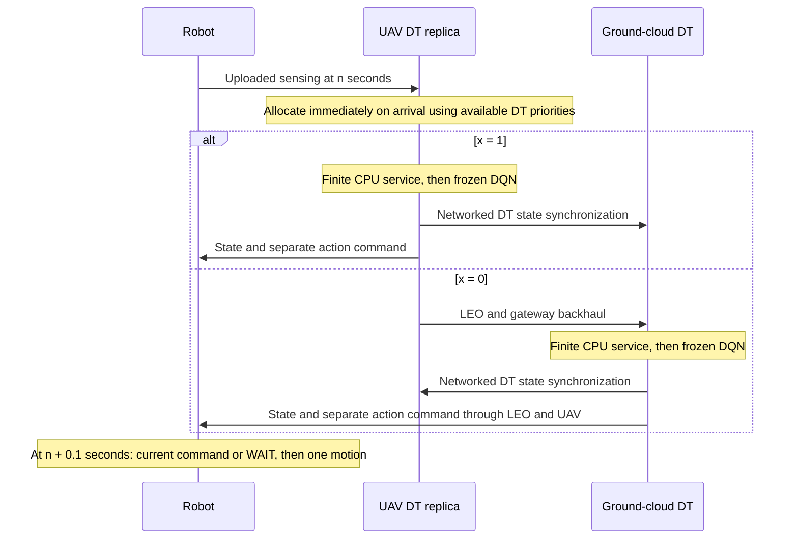

# Remote DT implementation and acceptance

`configs/paper_remote_dt.toml` selects `execution_mode="remote_dt"`. The legacy
`configs/paper_study.toml` is unchanged. Training and legacy inference retain their
existing dynamics and policy inputs. This mode evaluates a frozen, qualified
checkpoint; it does not train, broadcast updated models, or compute aboard LEO.

## Execution and clocks



The cloud is the authoritative DT store; the UAV maintains a delivered replica.
Updates computed at the UAV are usable there immediately and reach the cloud
through modeled synchronization. Cloud updates cannot appear at the UAV before
delivery. Both stores begin with an explicitly logged fresh briefing; neither
has free physical refresh after initialization. The `fresh` ideal reference is
the explicit exception: fresh replicas and zero communication/compute delay.

Each active robot senses its obstacle/occupancy FoV and own position/goal at
`n * seconds_per_step`. This raw sensing report is distinct from the DQN input.
It traverses access uplink, is allocated without waiting for peers, and traverses
backhaul if assigned to cloud. On CPU completion the chosen DT builds the frozen
network input from that uploaded sensing and its own delivered peer states.
Square-FoV clipping applies cell by cell. Full observation tensors, canonical
hashes, dependency source times and DT state references are recorded.

Action commands and atomic states `(intention, priority, completed)` are separate
messages. Commands include cycle, generation time, expiry, version and all dynamic
source dependencies. Only a complete current-cycle command received by the fixed
cutoff can execute. Expired commands cannot replay movement in a later cycle.
Missing current commands produce deterministic action 4 (WAIT). Source staleness
and missed delivery cutoffs are independent flags. Every used message satisfies
`source_min <= generation <= arrival <= decision`; source_min is the oldest
dynamic dependency. DQN wall time is measured separately from synthetic CPU work.

The simulator advances remaining service through each control interval, including
the last interval. It retains outstanding jobs and in-flight messages at the end;
it does not generate a new active compute task after the final control cycle.
First goal arrival is timestamped at motion/cutoff, while step-based makespan
retains the existing control-cycle convention.

## Allocation and physical accounting

Each arrival creates one undecided job. Existing compute and backhaul jobs enter
the snapshot with fixed execution routes and projected remaining cycles. Prior
access/backhaul charges are excluded from their new snapshot cost. The exact
binary reference enumerates only undecided routes (up to eight); the continuous
conic result is a snapshot lower bound. Fractional tasks never execute.

Processor pools reschedule on arrival and completion. Rates use remaining work and
admission weights, with the priority-weighted latency/DVFS KKT rule. Conditional
snapshot rates and actual time-varying service rates are distinct records. CPU
completion estimates do not guarantee mission completion or future service rates.
Failed solves save their snapshot and stop the affected condition.

The oracle shadow changes only priority coefficients in an otherwise identical
snapshot. Both the actual routes/rates and oracle optimum are scored under the
same physical-priority objective. Native objective values are also retained but
never subtracted as regret. Shadow action/local-control evaluation is separately
logged and cannot change real caches, queues, decisions or event checksums.

The controlled equal baseline assigns the active DT mean bounded priority weight
to every active robot. `equal_legacy` retains weight 1. Completed robots retain
weight 1. The other treatments are episode-initial static weights, AoI-only
weights, current DT PANAMA weights, and the ideal fresh reference.

The existing G2A RF equation, UAV placement and orbital link service are retained.
Cloud traffic includes both space legs, gateway/ground delay and one propagation
contribution per direction; serialization also applies to the return message.
The raw archived timeline is time varying. Rates, RF bounds, applied ceilings,
geometry, atmospheric attenuation and RF-limited sample counts remain explicit.
No stochastic packet loss or retransmission is inferred from path loss.

Energy includes robot access transmission, UAV backhaul transmission and UAV
dynamic computation. EIRP is distinct from conducted watts. Synchronization and
control traffic are counted. Finished chunks give the radio lower bound; a
partially served chunk contributes its whole airtime to the conservative upper
bound. Compute energy includes work already performed on unfinished jobs.
The bounds concern energy consumed by the observation horizon, not the future
energy required to finish all queued work. Cloud electricity, UAV propulsion,
receiver electronics and static processor power are outside this energy model.

## Configuration assumptions

| Setting | Remote acceptance configuration |
| --- | --- |
| Control interval / command cutoff | 1 s / 0.1 s |
| Logical task / work | 100,000 bits / 1,000 cycles per bit |
| UAV / ground-cloud capacity | 1e9 / 1e10 cycles/s |
| Robot / UAV conducted transmit power | 0.2 / 2 W |
| UAV dynamic coefficient | 1e-28 J / (cycle * (cycles/s)^2) |
| Resource weights | 1 through 4, smaller PANAMA distance priority is higher |
| Objective references / coefficients | 1 J and 1 s / energy 1 and latency 1 |
| Constant robot-upload term | Measured, omitted from the paper objective |
| Access / satellite uplink / downlink ceilings | 50 / 10 / 50 Mbps |
| Access / A2S bandwidth | 20 / 20 MHz |
| Thermal PSD / access noise figure | -174 dBm/Hz / 7 dB |
| A2S carrier / terminal EIRP | 14.25 GHz / 35 dBW |
| Satellite G/T / implementation loss / efficiency | -5 dB/K / 3 dB / 0.5 |
| Movement / square FoV / intention horizon | Four neighbors or WAIT / radius 7 / 5 steps |
| UAV motion | Existing received-position-based placement controller and configured bounds |
| Orbital source | Local archived `data/leo/tremblant_full.npz` |
| Packet model | 65,536-byte payload ceiling and 48-byte chunk overhead |
| Physical conflicts | Log, then resolve using delivered DT priorities |
| Task deadline tau | Omitted by default; independent of command cutoff |

These are numerical simulation assumptions, not hardware or network measurements.
Actual wire bits, all resolved configuration fields and asset hashes are saved in
each run. Retaining priority semantics does not imply qualifying this new control
architecture from the old policy's training performance.

`task_deadline_seconds` optionally enables a separate observed-deadline monitor.
With `enforce_task_deadlines=true`, both conic and enumerated binary references
also enforce analytical snapshot latency bounds. For those optional bounds,
binary enumeration solves a convex CPU problem for each fixed assignment;
unconstrained KKT rates are no longer sufficient. Historical elapsed access time
is removed from the remaining budget, and pending committed work retains its
remaining budget. Such constraints are scheduling-snapshot feasibility checks:
future arrivals, orbital interruptions, synchronization and response queues can
still cause observed deadline misses. Expired work is recorded, never silently
dropped. Default runs preserve the requested no-hard-deadline interpretation.

## Motion and completion

Physical vertex conflicts and swaps are detected before arbitration and logged
with attempted targets and command contexts. The user-selected `dt_resolve` rule
uses delivered command priorities, falling back to delivered self-state priority
on timeout. Stationary occupants keep their cells; swaps stop both robots, and
new conflicts from stopped robots are resolved to a stable safe configuration.
Fresh physical priority never chooses a winner. `terminate` remains an optional
explicit collision-failure treatment, which cannot count as mission success.

Completed robots remain physically present, retain lowest application priority,
submit one final status report, and generate no new inference jobs. A deterministic
local controller reads only square-FoV obstacles/occupancy and delivered active
peer intentions. It yields to a free cell outside those intentions and returns
toward its goal when locally clear. It is a local greedy controller, so it does
not guarantee escape/return around arbitrary unseen obstacles. First completion,
current goal occupancy, local control and post-goal motion are separate fields.

`sum_path_costs` counts one active control step until each robot's first goal
arrival; it includes active waits and censored failures. It is not physical path
length. Physical distance, active travel/waits, post-goal travel/waits and first
completion times are separate metrics. Mission success requires all robots to
occupy their goals without a collision failure.

## Records and replay

Versioned `remote_dt_v1` events record physical sensing/motion, generated and
delivered DT states, recipient cache accept/reject outcomes, allocations, full
remote observations, commands, cutoff decisions, and consistency checksums.
Immutable canonical payloads form a SHA-256 chain. Oracle diagnostics are outside
that actual-event chain. Archives also carry checkpoint, map, timeline, source
code and package identities from the run manifest.

The existing paper metric uses robot-cached self/peer order and predicted
vertex/edge conflicts in the square FoV. Authority-cloud order and the order
actually consumed by each selected remote DQN are reported separately. Pair
records retain physical/DT/cached paths, priorities, generation/source/arrival
times, vertex and swap indices, missed physical conflicts, false positives,
AoI decomposition, and zero/missing denominators. Physical conflict predictions
are fresh A* intentions, not knowledge of future DQN actions. Only the completed
local controller consumes robot-cached ordering for yielding; remote action
differences alone do not prove a robot-cache ordering effect.

Replay rebuilds delivered stores, DQN observations, dependency provenance, action
inboxes, local completion control, physical resolution, directed consistency,
source AoI, routes and final positions. Every episode is replay-audited before
being archived. Supplying the matching checkpoint additionally recomputes each
DQN action; hash mismatch rejects an incorrect checkpoint.

```powershell
.venv\Scripts\python.exe -m pytest -q --basetemp=tmp/pytest-remote-validation
.venv\Scripts\python.exe -m panama_uav allocation-sanity --output output/remote-sanity-new-id
.venv\Scripts\python.exe -m panama_uav --config configs/paper_remote_dt.toml resource-study --run-id remote-dt-new-id --model artifacts/inputs/final_model.pt --diagnostic --cases 1 --agents 2 4 6 8 --max-steps 8
.venv\Scripts\python.exe -m panama_uav --config configs/paper_remote_dt.toml remote-audit --input output/resources/remote-dt-new-id/up-1-cpu-1__priority/agents-2-case-000.json.gz --model artifacts/inputs/final_model.pt --output output/resources/remote-dt-new-id/priority-audit.json
```

All generated traces, evidence, plots and input assets remain ignored by Git.
Validation includes predictable independently checked allocation scenarios,
no-upload-barrier fixtures, fixed-route capacity accounting, stale priorities,
shadow noninterference, network timing, cache ordering, FoV conflict cases,
completion control, physical conflicts, archive tampering and legacy regressions.

## Acceptance and author follow-up

The new mode runs only the six nominal treatments above. It blocks non-diagnostic
experiments while `remote_acceptance_approved=false`; no old 97-condition sweep
or archived outputs are overwritten. Full runs still require a qualified model,
archived timeline, 50 paired cases per population and a 250-step cap.

The supplied plan mentions a revised vertex-only metric without its equation.
The supplied TeX/PDF still defines vertex-plus-edge relevance. Raw records support
the revision, but no unseen formula is claimed as implemented. The equation has
been requested; full research comparisons await that definition and acceptance.
The code follows the requested no-hard-deadline default and both UAV/cloud DT
execution sites. The manuscript's cloud-only descriptions, task-deadline claims,
robot-applied ordering interpretation, analytical omission of download bytes and
separate learning-study narrative require author review later. No new LaTeX or
paper text is produced by this implementation.
