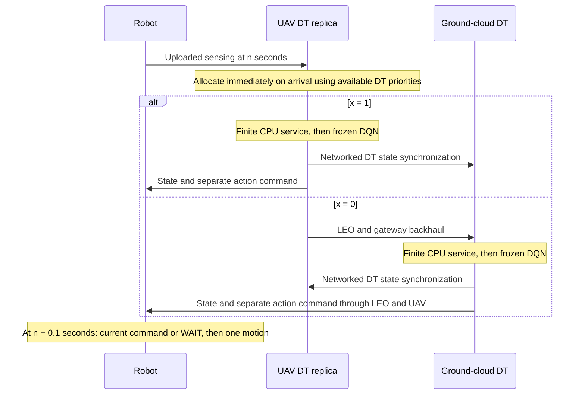

# Remote DT implementation and acceptance

`configs/paper_remote_dt.toml` selects `execution_mode="remote_dt"`. The legacy
`configs/paper_study.toml` is unchanged. Training and legacy inference retain their
existing dynamics and policy inputs. This mode evaluates a frozen, qualified
checkpoint; it does not train, broadcast updated models, or compute aboard LEO.

## Execution and clocks



The cloud is the authoritative DT store; the UAV maintains a delivered replica.
Updates computed at the UAV are usable there immediately and reach the cloud
through modeled synchronization. Cloud updates cannot appear at the UAV before
delivery. Both stores begin with an explicitly logged fresh briefing; neither
has free physical refresh after initialization. The `fresh` ideal reference is
the explicit exception: fresh replicas and robot coordination caches at each
epoch, with zero communication/compute delay. These ideal cache refreshes are
logged and replayed explicitly, including completed robots' current states.

Each active robot senses its obstacle/occupancy FoV and own position/goal at
`n * seconds_per_step`. This raw sensing report is distinct from the DQN input.
It traverses access uplink, is allocated without waiting for peers, and traverses
backhaul if assigned to cloud. On CPU completion the chosen DT builds the frozen
network input from that uploaded sensing and its own delivered peer states.
Square-FoV clipping applies cell by cell. Full observation tensors, canonical
hashes, dependency source times and DT state references are recorded.

Action commands and atomic states `(intention, priority, completed)` are separate
messages. Commands include cycle, generation time, expiry, version and all dynamic
source dependencies. Only a complete current-cycle command received by the fixed
cutoff can execute. Expired commands cannot replay movement in a later cycle.
Missing current commands produce deterministic action 4 (WAIT). Source staleness
and missed delivery cutoffs are independent flags. Every used message satisfies
`source_min <= generation <= arrival <= decision`; source_min is the oldest
dynamic dependency. DQN wall time is measured separately from synthetic CPU work.

The simulator advances remaining service through each control interval, including
the last interval. It retains outstanding jobs and in-flight messages at the end;
it does not generate a new active compute task after the final control cycle.
First goal arrival is timestamped at motion/cutoff, while step-based makespan
retains the existing control-cycle convention.

## Allocation and physical accounting

Each arrival creates one undecided job. Existing compute and backhaul jobs enter
the snapshot with fixed execution routes and projected remaining cycles. Prior
access/backhaul charges are excluded from their new snapshot cost. The exact
binary reference enumerates only undecided routes (up to eight); the continuous
conic result is a snapshot lower bound. Fractional tasks never execute.

Processor pools reschedule on arrival and completion. Rates use remaining work and
admission weights, with the priority-weighted latency/DVFS KKT rule. Conditional
snapshot rates and actual time-varying service rates are distinct records. CPU
completion estimates do not guarantee mission completion or future service rates.
Failed solves save their snapshot and stop the affected condition.

The oracle shadow changes only priority coefficients in an otherwise identical
snapshot. Both the actual routes/rates and oracle optimum are scored under the
same physical-priority objective. Native objective values are also retained but
never subtracted as regret. Shadow action/local-control evaluation is separately
logged and cannot change real caches, queues, decisions or event checksums.

Active robots also have a separate `decision_action_shadow` at every decision
cutoff when oracle diagnostics are enabled. It compares the action actually
selected for that cycle, including timeout WAIT, with a fresh frozen-DQN action
from physical sensing and an evaluation-only fresh replica at that same cutoff.
The record retains cycle/robot identity, cutoff, command availability, both
actions, observation/hash, source times and model version. It never enqueues work,
sends a command or updates actual DT state. Completed robots keep the separate
local-control shadow. Existing `action_shadow` records and metrics remain
compute-completion diagnostics; `decision_action_shadow_*` metrics count the
cutoff comparisons, disagreements and missed-command cases independently.

The controlled equal baseline assigns the active DT mean bounded priority weight
to every active robot. `equal_legacy` retains weight 1. Completed robots retain
weight 1. The other treatments are episode-initial static weights, AoI-only
weights, current DT PANAMA weights, and the ideal fresh reference.

The existing G2A RF equation, UAV placement and orbital link service are retained.
Cloud traffic includes both space legs, gateway/ground delay and one propagation
contribution per direction; serialization also applies to the return message.
The raw archived timeline is time varying. Rates, RF bounds, applied ceilings,
geometry, atmospheric attenuation and RF-limited sample counts remain explicit.
No stochastic packet loss or retransmission is inferred from path loss.

Energy includes robot access transmission, UAV backhaul transmission and UAV
dynamic computation. EIRP is distinct from conducted watts. Synchronization and
control traffic are counted. Finished chunks give the radio lower bound; a
partially served chunk contributes its whole airtime to the conservative upper
bound. Compute energy includes work already performed on unfinished jobs.
The bounds concern energy consumed by the observation horizon, not the future
energy required to finish all queued work. Cloud electricity, UAV propulsion,
receiver electronics and static processor power are outside this energy model.

## Configuration assumptions

| Setting | Remote acceptance configuration |
| --- | --- |
| Control interval / command cutoff | 1 s / 0.1 s |
| Logical task / work | 100,000 bits / 1,000 cycles per bit |
| UAV / ground-cloud capacity | 1e9 / 1e10 cycles/s |
| Robot / UAV conducted transmit power | 0.2 / 2 W |
| UAV dynamic coefficient | 1e-28 J / (cycle * (cycles/s)^2) |
| Resource weights | 1 through 4, smaller PANAMA distance priority is higher |
| Objective references / coefficients | 1 J and 1 s / energy 1 and latency 1 |
| Constant robot-upload term | Measured, omitted from the paper objective |
| Access / satellite uplink / downlink ceilings | 50 / 10 / 50 Mbps |
| Access / A2S bandwidth | 20 / 20 MHz |
| Thermal PSD / access noise figure | -174 dBm/Hz / 7 dB |
| A2S carrier / terminal EIRP | 14.25 GHz / 35 dBW |
| Satellite G/T / implementation loss / efficiency | -5 dB/K / 3 dB / 0.5 |
| Movement / square FoV / intention horizon | Four neighbors or WAIT / radius 7 / 5 steps |
| UAV motion | Existing received-position-based placement controller and configured bounds |
| Orbital source | Local archived `data/leo/tremblant_full.npz` |
| Packet model | 65,536-byte payload ceiling and 48-byte chunk overhead |
| Physical conflicts | Log, then resolve using delivered DT priorities |
| Measured end-to-end task deadline | 0.1 s from sensing to complete command arrival |
| Hard optimizer deadline constraints | Disabled (`enforce_task_deadlines=false`) |

These are numerical simulation assumptions, not hardware or network measurements.
Actual wire bits, all resolved configuration fields and asset hashes are saved in
each run. Retaining priority semantics does not imply qualifying this new control
architecture from the old policy's training performance.

`configs/paper_remote_dt.toml` sets `task_deadline_seconds=0.1`, matching its
decision and command cutoffs. This is a **measured end-to-end deadline**:
`first_complete_command_arrival_at_robot - task_sensing_time <= 0.1 s`.
Arrivals exactly at 100 ms are on time (1 ps floating-point comparison tolerance).
The sensing-to-arrival span includes access uplink, all queueing and compute
service, cloud backhaul where selected, propagation, and downlink serialization.
Compute completion, command generation, command acceptance, and command use are
separate events; none substitutes for arrival at the robot. The start timestamp
is the task's own sensing time, not the oldest peer source used in its observation.

The optimizer's `predicted_latency_seconds` is the fixed-input analytical
scheduling estimate. Actual queues, changing processor shares, orbital service,
synchronization traffic and response serialization can make measured latency
different. A prediction below 100 ms does not establish measured deadline
compliance. `enforce_task_deadlines=false` keeps hard solver constraints off;
binary allocation, processor service, radio scheduling, PANAMA, oracle diagnostics
and motion are unchanged. The pre-existing opt-in solver-deadline capability is
not used by this configuration. Other configurations retain their existing
optional deadline setting; the generic default remains unmonitored.

Each logical task has exactly one `deadline_status`: `on_time`, `late`, or
`undelivered` when monitoring is enabled, and `disabled` otherwise. The first
complete command arrival fixes its delivered outcome; duplicate arrivals cannot
overwrite that timestamp or count as extra completed tasks. `commands_delivered`
retains its historical message-arrival count; `commands_delivered_unique` and
`duplicate_command_arrivals` make that distinction explicit.

`deadline_commands_on_time + deadline_commands_late + deadline_commands_undelivered`
equals `deadline_tasks_monitored`. Undelivered tasks have right-censored latency:
before their deadline they are pending, with `deadline_met=null`; once the
observation horizon reaches the deadline without an arrival, they are known
deadline misses even though final latency remains unknown. Late arrivals move
from the undelivered category to late; they do not create another missed task.
`task_deadline_misses` equals late arrivals plus overdue undelivered tasks.
`deadline_compliance_rate` divides on-time tasks by all assessed tasks (on-time,
late, and overdue undelivered), excluding still-pending tasks. No monitor means
the on-time/late category counts and compliance rate are null, not assumed zero.

`cutoff_induced_wait` and `command_cutoff_at` join each task to its actual decision
epoch. WAITs and `deadline_censored` are additional tags, not extra deadline
failures: a task that causes a timeout WAIT and arrives late is still one missed
task. `deadline_cutoff_wait_tasks`, `deadline_censored_tasks`, pending tasks and
overdue undelivered tasks are reported separately. Expired/unfinished work remains
in the transport and compute accounting; monitoring never cancels or reroutes it.

## Motion and completion

Physical vertex conflicts and swaps are detected before arbitration and logged
with attempted targets and command contexts. The `dt_resolve` rule
uses delivered command priorities, falling back to delivered self-state priority
on timeout. Stationary occupants keep their cells; swaps stop both robots, and
new conflicts from stopped robots are resolved to a stable safe configuration.
Fresh physical priority never chooses a winner. `terminate` remains an optional
explicit collision-failure treatment, which cannot count as mission success.

Completed robots remain physically present, retain lowest application priority,
submit one final status report, and generate no new inference jobs. A deterministic
local controller reads only square-FoV obstacles/occupancy and delivered active
peer intentions. It yields to a free cell outside those intentions and returns
toward its goal when locally clear. It is a local greedy controller, so it does
not guarantee escape/return around arbitrary unseen obstacles. First completion,
current goal occupancy, local control and post-goal motion are separate fields.

`sum_path_costs` counts one active control step until each robot's first goal
arrival; it includes active waits and censored failures. It is not physical path
length. Physical distance, active travel/waits, post-goal travel/waits and first
completion times are separate metrics. Mission success requires all robots to
occupy their goals without a collision failure.

## Records and replay

Versioned `remote_dt_v1` events record physical sensing/motion, generated and
delivered DT states, recipient cache accept/reject outcomes, allocations, full
remote observations, commands, cutoff decisions, and consistency checksums.
Immutable canonical payloads form a SHA-256 chain. Oracle diagnostics are outside
that actual-event chain. Archives also carry checkpoint, map, timeline, source
code and package identities from the run manifest.

The existing paper metric uses robot-cached self/peer order and predicted
vertex/edge conflicts in the square FoV. Authority-cloud order and the order
actually consumed by each selected remote DQN are reported separately. Pair
records retain physical/DT/cached paths, priorities, generation/source/arrival
times, vertex and swap indices, missed physical conflicts, false positives,
AoI decomposition, and zero/missing denominators. Physical conflict predictions
are fresh A* intentions, not knowledge of future DQN actions. Only the completed
local controller consumes robot-cached ordering for yielding; remote action
differences alone do not prove a robot-cache ordering effect.

The additional **exploratory vertex-only variant** preserves that original metric.
For each directed pair at the decision cutoff, let `zeta_vertex` indicate a cached
vertex conflict inside the same square FoV and horizon. Its contributions are
`vertex_e2e_error = zeta_vertex * E2E_ordering_error` and
`vertex_aoi_weighted_error = vertex_e2e_error * max(self_AoI, peer_AoI) / age_reference`.
`xi_vertex_e2e` and `xi_vertex_aoi` divide their respective contribution sums by
the number of vertex-relevant directed pairs. Empty denominators return zero
with an explicit zero-denominator flag. The AoI-weighted value can exceed one.
Episode metrics pool the numerators and vertex denominators across decision
epochs, rather than borrowing the original vertex-plus-edge denominator.

The three indicators (`current_order`, `digital_twin_order`, `cached_order`) and
three errors (`uplink_ordering_error`, `downlink_ordering_error`, `e2e_ordering_error`)
are retained and verified from their raw physical/DT/cached priorities at every
cutoff. Cached order always compares cached self with cached peer. Raw intentions
and source/generation/arrival timestamps remain available. Vertex missed-conflict
and false-positive counts are separate from the original union-of-vertex-and-edge
counts. Pair counts assess existence within the horizon; step counts compare
`(step, cell)` predictions, also exposing a conflict predicted at the wrong cell.

Derived consistency records use schema 2. Replay verifies schema-1 archives against
their original checksums, then derives the new metrics without rewriting evidence.
The vertex-only variant is an exploratory implementation diagnostic. It has no
confirmed revised manuscript equation and remains separate from the original metric.

Replay rebuilds delivered stores, DQN observations, dependency provenance, action
inboxes, local completion control, physical resolution, directed consistency,
source AoI, routes and final positions. Every episode is replay-audited before
being archived. Supplying the matching checkpoint additionally recomputes each
DQN action; hash mismatch rejects an incorrect checkpoint.

```powershell
.venv\Scripts\python.exe -m pytest -q --basetemp=tmp/pytest-remote-validation
.venv\Scripts\python.exe -m panama_uav allocation-sanity --output output/remote-sanity-new-id
.venv\Scripts\python.exe -m panama_uav --config configs/paper_remote_dt.toml resource-study --run-id remote-dt-new-id --model artifacts/inputs/final_model.pt --diagnostic --cases 1 --agents 2 4 6 8 --max-steps 8
.venv\Scripts\python.exe -m panama_uav --config configs/paper_remote_dt.toml remote-audit --input output/resources/remote-dt-new-id/up-1-cpu-1__priority/agents-2-case-000.json.gz --model artifacts/inputs/final_model.pt --output output/resources/remote-dt-new-id/priority-audit.json
```

All generated traces, evidence, plots and input assets remain ignored by Git.
Validation includes predictable independently checked allocation scenarios,
no-upload-barrier fixtures, fixed-route capacity accounting, stale priorities,
shadow noninterference, network timing, cache ordering, FoV conflict cases,
completion control, physical conflicts, archive tampering and legacy regressions.

## Execution gates and analytical scope

The new mode runs only the six nominal treatments above. It blocks non-diagnostic
experiments while `remote_acceptance_approved=false`; no old 97-condition sweep
or archived outputs are overwritten. Full runs still require a qualified model,
archived timeline, 50 paired cases per population and a 250-step cap.

The manuscript defines vertex-plus-edge relevance. The simulator retains it and
records a separate exploratory vertex-only variant. The full-run gate is enabled
only in the dedicated 250 ms configuration; other configurations retain their
own gate settings. The default remote-DT configuration measures a 100 ms
end-to-end deadline without hard solver constraints and supports UAV and cloud
execution. Differences from the manuscript include the cloud-only analytical
execution assumption, deadline enforcement, the interpretation of robot-cached
ordering, and explicit result-download serialization. These distinctions must be
retained when interpreting simulation results.

## Command deadline sensitivity

`deadline-study` runs the existing six treatments at **100, 250, 300 and 500 ms**.
It changes `decision_budget_seconds`, `command_cutoff_seconds` and
`task_deadline_seconds` together, keeps `enforce_task_deadlines=false`, and requires
a 1-second control interval. CPU capacities, task sizes, energy coefficients,
PANAMA, binary routing, radio scheduling, oracle diagnostics and original metrics
are unchanged. Each scenario executes its own closed loop with the new cutoff;
this is not post-processing of a fixed trajectory. Physical motion and fresh
oracle evaluation occur at that cycle's cutoff, while sensing stays at integer
seconds. A longer cutoff can change later positions, allocations and mission
duration, so compliance need not increase monotonically across complete episodes.

The default is **one paired case per population**, with a 250-step cap. All four
scenarios use identical held-out starts/goals, seeds, orbital offsets, map, frozen
checkpoint and archived timeline. A shared case bank and asset/source hashes are
checked against each child manifest, every treatment configuration and episode.
Each child run retains the existing per-task, allocation, oracle and replay-audited
archives. Failed conditions stop the workflow and retain their evidence. Resume
requires matching inputs, configuration and source identities. Full studies retain
the acceptance gate; this pilot does not enable it.

```powershell
.venv\Scripts\python.exe -m panama_uav --config configs/paper_remote_dt.toml deadline-study --run-id deadline-pilot-new-id --model artifacts/inputs/final_model.pt --diagnostic --cases 1 --agents 2 4 6 8 --max-steps 250 --workers 2
.venv\Scripts\python.exe -m panama_uav deadline-report --path output/deadlines/deadline-pilot-new-id
```

The output contains `deadline-100ms/` through `deadline-500ms/`, a parent manifest
with all assumptions, and CSV/JSONL comparison tables:

- `episodes`: original episode metrics plus measured arrival rates and assigned
  UAV/cloud shares, with one row per case, cutoff and treatment.
- `summary`: one row per cutoff, treatment and population; pooled command counts
  and rates, mean cutoff WAITs, success rate, mean successful makespan, capped
  mission duration, active waiting, and pooled delivered-task latency p95.
- `execution_locations`: UAV (`drone`), ground cloud (`cloud`) and `unassigned`
  populations, each with on-time/late/undelivered counts, rates and compliance.
- `paired_vs_100ms`: matched-case changes from 100 ms for timing, offloading and
  mission outcomes. One-case comparisons have no confidence interval. Successful
  makespan deltas use only pairs successful in both runs; capped duration retains
  failed/censored missions. Makespan uses the existing control-cycle convention,
  so one step equals one second here.

On-time, late and undelivered **arrival rates divide by all monitored logical
tasks** and sum to one when that population is nonempty. Compliance divides by
assessed tasks, excluding still-pending tasks and including overdue undelivered
tasks. Cutoff WAITs and censored tasks are separate tags and never additional
misses. Final classifications are pooled using each episode's own horizon.
UAV/cloud offloading fractions divide by assigned tasks; the separate unassigned
fraction divides by all tasks. Locations with no tasks have null compliance/rates,
not an assumed 100%. The fresh reference is ideal zero-delay execution; its cloud
label does not represent actual cloud service or RF traffic. Latency p95 uses all
delivered commands, including late arrivals, and cannot impute censored latency.

`figures/` compares timeliness, late/undelivered fractions, cutoff WAITs, mission
duration/success, waiting, task p95, UAV offloading share and per-location deadline
compliance against cutoff. All generated tables, plots and evidence stay local
under ignored `output/`; only implementation, tests and documentation are tracked.
